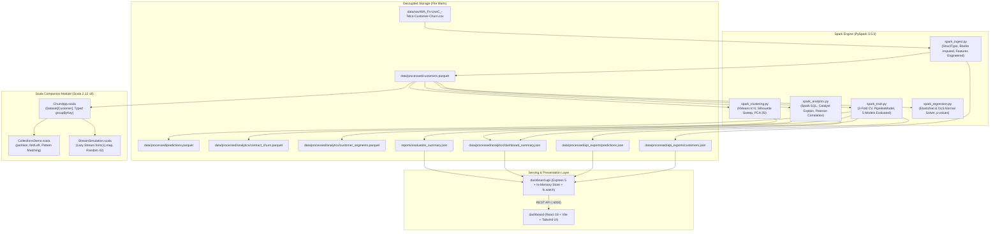

# Telco Customer Churn Analytics: Apache Spark & Scala Architecture

A production-grade, database-free analytical and machine learning platform built on **Apache Spark 3.5.3**, **PySpark**, **Spark SQL**, **Spark MLlib**, and a **Scala 2.12 companion module**. The platform eliminates database servers entirely, managing data as columnar **Parquet** and **JSON** analytical data marts served via a decoupled **Express 5** API to an interactive **React 18** dashboard.

---

## 1. Architectural Highlights

- **Zero Database Servers**: Removed MongoDB, pymongo, and database drivers. Analytical marts are persisted as snappy-compressed Parquet files and static JSON files.
- **Unified Engine**: Local multi-threaded Apache Spark standalone mode (`local[*]`) with Adaptive Query Execution (AQE) enabled and Catalyst/Tungsten optimizers.
- **Reproducible Data Science**: Fixed random seed (`42`) across stratified data splitting, MLlib cross-validation, and K-Means clustering.
- **Zero Data Leakage**: All preprocessing transformers (`StringIndexer`, `OneHotEncoder`, `VectorAssembler`, `StandardScaler`) reside strictly inside the `Pipeline` object; evaluated on a raw stratified hold-out partition (no synthetic oversampling / SMOTE).
- **Dual-Language Architecture**: Python PySpark data engineering and ML pipeline alongside a typed Scala 2.12 Dataset companion application demonstrating functional patterns, immutable collections, and lazy streams.

---

## 2. System Architecture



---

## 3. Repository Structure

```
Telco-Churn-Analytics/
├── archive_old_mongodb/                              # Archived legacy MongoDB scripts
├── data/
│   ├── raw/WA_Fn-UseC_-Telco-Customer-Churn.csv      # Raw dataset (7,043 rows, 21 cols)
│   └── processed/
│       ├── customers.parquet                         # Curated parquet dataset (27 cols)
│       ├── customers_csv/                            # Single-file CSV export
│       ├── predictions.parquet                       # Customer predictions mart
│       ├── analytics/
│       │   ├── contract_churn.parquet                # Churn aggregation by contract
│       │   ├── customer_segments.parquet             # KMeans cluster assignments
│       │   └── dashboard_summary.json                # Pre-aggregated KPI & risk metrics
│       └── api_exports/
│           ├── customers.json                        # 7,043 records for API queries
│           └── predictions.json                      # 7,043 scored records sorted by risk
├── models/
│   └── spark_rf_pipeline/                            # Saved Spark MLlib PipelineModel
├── reports/
│   ├── evaluation_summary.json                       # Hold-out metrics & confusion matrices
│   ├── model_comparison.csv                          # Benchmark summary table across 5 models
│   ├── regression_summary.json                       # OLS & ElasticNet coefficients & p-values
│   ├── clustering_summary.json                       # Silhouette sweep & cluster profiles
│   ├── correlation_matrix.json                       # Spark MLlib Pearson correlation matrix
│   ├── feature_importance.png                        # Random Forest top-10 feature plot
│   ├── correlation_heatmap.png                       # Seaborn correlation heatmap
│   └── customer_clusters.png                         # 2D PCA cluster visualization
├── spark-pipeline/
│   ├── requirements.txt                              # PySpark 3.5.3, pandas, matplotlib, seaborn
│   ├── config.py                                     # Paths, constants, feature engineering
│   ├── spark_session.py                              # SparkSession factory (local[*], AQE, 4GB)
│   ├── spark_ingest.py                               # Explicit schema ingestion & imputation
│   ├── spark_analytics.py                            # Spark SQL analytics & caching benchmark
│   ├── spark_train.py                                # MLlib pipelines, 3-fold CV & holdout eval
│   ├── spark_clustering.py                           # KMeans clustering & PCA visualization
│   └── spark_regression.py                           # MonthlyCharges OLS inference
├── scala-companion/
│   ├── build.sbt                                     # SBT build specification
│   ├── project/build.properties                      # SBT 1.9.9
│   └── src/main/scala/telco/churn/
│       ├── ChurnApp.scala                            # Spark Dataset[Customer] driver
│       ├── CollectionsDemo.scala                     # Functional collections & pattern matching
│       └── StreamSimulation.scala                    # Infinite lazy stream demonstration
├── dashboard-api/
│   ├── package.json                                  # Express 5, CORS (zero database drivers)
│   ├── .env                                          # PORT=4000, DATA_DIR, REPORTS_DIR
│   └── server.js                                     # High-performance in-memory caching API
├── dashboard/                                        # React 18 + Vite frontend
├── docs/
│   └── SPARK_VS_HADOOP.md                            # Detailed MapReduce vs Spark analysis
├── SPARK_SCALA_VIVA_GUIDE.md                         # Viva defense Q&A reference
└── README.md
```

---

## 4. Measured Verification Results

All numbers below represent **actual outputs computed on the raw dataset**:

| Component | Metric | Measured Value | Acceptance Criterion |
|---|---|---|---|
| **Ingestion** | Total Rows / Columns | **7,043 rows / 27 cols** | Exactly 7,043 rows, 21 raw cols, 0 duplicates |
| **Imputation** | Blank TotalCharges | **11 imputed** | 11 zero-tenure rows imputed |
| **Analytics** | Overall Churn Rate | **26.54% (1,869 / 7,043)** | 26.54% |
| **Contract Churn** | Month-to-Month / 1-Yr / 2-Yr | **42.71% / 11.27% / 2.83%** | ≈ 42.71% / 11.27% / 2.83% |
| **Correlation** | tenure $\leftrightarrow$ TotalCharges | **0.8262** | ≈ 0.826 |
| **Caching Benchmark** | Uncached vs. Cached Speedup | **1.03s vs. 0.80s (1.29x)** | Demonstrated RAM speedup |
| **Baseline Accuracy** | Test Majority-Class Accuracy | **72.42%** | Holdout majority class baseline |
| **Logistic Regression** | Test Accuracy / ROC-AUC | **80.89% / 0.8369** | Hold-out evaluation |
| **Random Forest (Tuned)** | Test Accuracy / ROC-AUC | **78.96% / 0.8317** | Hold-out evaluation |
| **Gradient Boosted Trees** | Test Accuracy / ROC-AUC | **77.55% / 0.8293** | Hold-out evaluation |
| **Linear SVC** | Test Accuracy / ROC-AUC | **79.03% / 0.8274** | Hold-out evaluation |
| **Scoring Mart** | Scored Customers / Risk Counts | **7,043 (864 High / 1,634 Med / 4,545 Low)** | Exactly 7,043 records in [0, 1] |
| **Clustering** | 4-Cluster Churn Rates | **1.41% to 39.67%** | Spans ≈ 1.4% to ≈ 40% |
| **Regression (OLS)** | Train R² / Test R² | **0.9989 / 0.9988** | Test R² ≈ 0.999 |
| **Express API** | Response Latency | **< 50 ms (in-memory)** | Fast sub-second endpoints |

---

## 5. Execution Instructions

### Prerequisites
- Python 3.10+ (Python 3.13 tested)
- Java Development Kit: JDK 11, 17, or 21 (JDK 21 tested)
- Node.js 20+
- SBT (Scala Build Tool)
- Windows utility binaries: `C:\hadoop\bin\winutils.exe` and `hadoop.dll`

### Step-by-Step Run Order

#### 1. Setup Python Environment & Install Dependencies
```powershell
python -m venv .venv
.\.venv\Scripts\Activate.ps1
pip install -r spark-pipeline/requirements.txt
```

#### 2. Run Spark Data Pipeline
```powershell
python spark-pipeline/spark_ingest.py
python spark-pipeline/spark_analytics.py
python spark-pipeline/spark_train.py          # ~3 minutes (hyperparameter cross-validation)
python spark-pipeline/spark_clustering.py
python spark-pipeline/spark_regression.py
```

#### 3. Run Scala Companion Application
```powershell
cd scala-companion
sbt run
cd ..
```

#### 4. Launch Decoupled Analytical API
```powershell
cd dashboard-api
npm install
npm start
```
*API runs on `http://localhost:4000` with endpoints `/api/health`, `/api/dashboard`, `/api/customers`, `/api/predictions`, `/api/model`, `/api/segments`.*

#### 5. Launch React Dashboard
```powershell
cd dashboard
npm install
npm run dev
```
*Frontend runs on `http://localhost:5173`.*

---

## 6. Lakehouse & Cloud Deployment Roadmap

For enterprise production deployments processing hundreds of millions of customer records:
1. **Storage Layer**: Migrate file marts to **Delta Lake** or **Apache Iceberg** tables on AWS S3 / Google Cloud Storage, leveraging ACID transactions, time travel, and schema evolution.
2. **Compute Clusters**: Deploy Spark jobs via **Amazon EMR**, **Databricks**, or **Google Cloud Dataproc** managed clusters with automated node scaling.
3. **Model Governance**: Register Spark ML Pipelines directly in an **MLflow** Model Registry with automated artifact lineage and staging-to-production promotion.
4. **Streaming**: Ingest live telecommunication events via Apache Kafka and process micro-batches using **Spark Structured Streaming** scoring against the saved `PipelineModel`.
